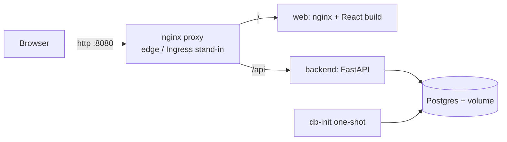

# Multi-user Task Manager

A small MVC-inspired task manager using FastAPI, React, PostgreSQL, Docker Compose, and Kind.

## 1. Overview

Choose a demo user, then create, update, filter, and delete that user's tasks. Authentication is not implemented.



## 2. Tech stack

| Area | Choice |
|---|---|
| API / data | Python, FastAPI, SQLAlchemy, PostgreSQL 16 |
| UI | React + TypeScript, built with Vite into browser JavaScript |
| Local deployment | Docker Compose, Nginx; optional Kind/Kubernetes |
| Checks | GitHub Actions, pytest/ruff, Vitest/ESLint/Prettier |

## 3. Project structure

```
backend/app/
  controllers/   HTTP routes       services/      business logic
  repositories/  database access   models/        SQLAlchemy tables
  schemas/       API validation    core/          shared utilities
  db/            sessions and schema init
frontend/src/    models, API client, hooks, and views
backend/tests/   API tests         k8s/           Kubernetes manifests
nginx/           proxy configs     scripts/       smoke test and Kind helpers
.github/workflows/ci.yml            docker-compose.yml
```

## 4. Prerequisites and Windows notes

To **run the app** you only need Docker Desktop (with Compose) and Git. Node, Python, Nginx and
React are not needed on the host; everything builds inside containers.

| Need | For | Install (Windows) |
|---|---|---|
| Docker Desktop (WSL2 backend) | running the app | `winget install Docker.DockerDesktop` |
| Git (includes Git Bash) | cloning, running `scripts/*.sh` | `winget install Git.Git` |
| Node 20+, Python 3.12+ | developing/testing outside Docker | optional |
| `kind`, `kubectl` | Kubernetes section | `winget install Kubernetes.kind Kubernetes.kubectl` |
| `act` | running CI locally | optional, `winget install nektos.act` |

### Note on Windows

- WSL2 needs admin once to enable. Starting values for `%UserProfile%\.wslconfig`
  (tune with Task Manager): `[wsl2]` / `memory=12GB` / `processors=8`, then `wsl --shutdown`.
- `.gitattributes` forces LF line endings for scripts, Dockerfiles and configs (CRLF breaks
  containers). Run the `.sh` scripts from Git Bash or WSL.
- macOS/Linux work as-is (Docker Desktop or Docker Engine). But I haven't tested this.

## 5. Quick start

```bash
git clone <repo> && cd <repo>
docker compose up -d --build          # no .env needed; defaults are dev-only
bash scripts/integration-test.sh      # smoke test through the proxy
```

Open http://localhost:8080 (API docs: http://localhost:8080/api/docs). Stop with
`docker compose down`; the `pgdata` volume persists. `docker compose down -v` deletes it.

**Optional HTTPS:** `docker compose --profile https up -d --build`, then https://localhost:8443.
A throw-away self-signed certificate is generated into `certs/` by an `openssl` container, so no
host tooling is needed; the browser shows a one-time warning. For a trusted certificate install
[mkcert](https://github.com/FiloSottile/mkcert), run `mkcert -install` once (needs admin), generate
`certs/tls.crt` and `certs/tls.key` with `mkcert -cert-file certs/tls.crt -key-file certs/tls.key localhost`.
Certificates are machine-specific and git-ignored.

## 6. Tests, lint and CI

```bash
# Backend, from the repository root (Python 3.12+)
cd backend
python -m venv .venv
. .venv/bin/activate  # Windows PowerShell: .venv\Scripts\Activate.ps1
pip install -r requirements-dev.txt
ruff check . && ruff format --check . && pytest
cd ..

# Frontend, from the repository root (Node 20+)
cd frontend
npm ci
npm run lint && npm test && npm run build
```

GitHub Actions ([workflow](.github/workflows/ci.yml)) runs backend/frontend checks, then builds and smoke-tests Compose. `act -j backend` and `act -j frontend` can run the non-integration jobs locally.

## 7. Kubernetes with Kind

Kind runs Kubernetes nodes in Docker. Deploy manually (requires Docker, `kind`, and `kubectl`):

```bash
bash scripts/kind-up.sh                                   # cluster, images, ingress, app
bash scripts/integration-test.sh http://localhost:8081
bash scripts/kind-down.sh
```

Concepts, mapped to this repo:

| Concept | Here | Compose analogue |
|---|---|---|
| Deployment | `k8s/40-backend.yaml`, `50-frontend.yaml`: keeps N pods running, rolling updates | `restart:` |
| Service | stable DNS name (`backend:8000`) in front of changing pod IPs | service name |
| Ingress | `k8s/60-ingress.yaml`: `/api` to backend, `/` to frontend | `proxy` service |
| ConfigMap / Secret | `k8s/10-config.yaml` (Secret is dev-only) | `.env` |
| PVC | Postgres volume claim in `20-postgres.yaml` | named volume |
| Probes | liveness restarts a hung pod; readiness withholds traffic | `healthcheck` |
| HPA | HorizontalPodAutoscaler, 2-5 backend pods at 70% CPU | none |
| Job | `db-init`, creates tables once | `db-init` service |

Self-healing demo: `kubectl delete pod -n taskapp -l app=backend --wait=false` and watch
`kubectl get pods -n taskapp -w`; the Deployment replaces them and the Service routes around the gap.
Autoscaling needs load; `kubectl top pods -n taskapp` shows usage. Resource units: CPU in
millicores (`1000m` = one core), memory in `Mi` (mebibytes).

## 8. MVC mapping

| MVC | Backend | Frontend |
|---|---|---|
| Model | `models/` defines database tables; `repositories/` reads and writes them | `models/` defines TypeScript data shapes; `api/` retrieves them |
| View | JSON response defined by `schemas/` | `views/` renders the UI |
| Controller | `controllers/` handles HTTP; `services/` holds business rules | `controllers/` hooks coordinate UI state and actions |

Backend request flow is **controller -> service -> repository -> model/database**; response data
is validated and shaped by a schema on its way back. Each layer has a distinct job:

- **Controller** (`app/controllers/`): maps HTTP requests to service calls and results to HTTP
  responses. It handles transport concerns, not business policy.
- **Schema** (`app/schemas/`): validates request data and defines response contracts. For example,
  `TaskCreate` validates a task body and `TaskRead` serializes a SQLAlchemy task.
- **Service** (`app/services/`): applies business rules such as task ownership, due-date checks,
  and publishing domain events. It does not depend on HTTP or issue SQL queries.
- **Repository** (`app/repositories/`): performs SQLAlchemy queries and persistence. Task queries
  are scoped by `user_id` so one user cannot access another user's task through these operations.
- **Model** (`app/models/`): maps Python classes and fields to database tables and constraints.
- **Core** (`app/core/`): shared concerns such as settings, logging, domain errors, security seam,
  and the event-publisher abstraction.
- **Dependency wiring** (`app/dependencies.py`): constructs repositories and services and provides
  them to FastAPI routes. `main.py` maps domain errors to HTTP responses.

Example: `POST /api/users` is validated as `UserCreate`, handled by the users controller, and sent
to `UserService.create()`. The service calls the repository, which inserts the `User` model;
`UserRead` shapes the response. The database unique constraint rejects duplicate names, and the
service maps that specific conflict to HTTP 409.

### Note on MVC and Hooks

- Hooks hold state, which blurs the line between model and controller.
- This is MVC by analogy, not true MVC: there is no observer pattern; React re-renders on state change.
- Without the MVC requirement I would use feature folders (`features/tasks/...`) and TanStack Query
  for server state, which would replace most of `useTasks`.

## 9. Principles and patterns

- **Single Responsibility Principle (SRP)**: controllers handle HTTP, services coordinate business
  operations, repositories handle persistence, and schemas define API data contracts.
- **Dependency Inversion Principle (DIP), partial**: `TaskService` depends on the `EventPublisher`
  protocol rather than a concrete event adapter. It still depends on concrete repository classes,
  so the repository boundary is not fully inverted behind an interface.
- **Open/Closed Principle (OCP), limited**: the event adapter can be replaced through
  `get_event_publisher()` without changing `TaskService`; the current adapter only logs and no queue
  is implemented.
- **DRY**: limits in `core/constants.py`; shared Nginx routes in `nginx/routes.conf`;
  one compose anchor for backend settings; one HTTP client in the frontend.
- **YAGNI**: no auth, no migrations tool, no cache, no queue. Seams exist; machinery does not.
- **CUPID**: small composable units (one function per route), domain-based names, predictable
  structure, plain-Python services that are easy to test.

Patterns present in this code:

- **Repository**: `UserRepository` and `TaskRepository` centralize SQLAlchemy queries and writes.
- **Service Layer**: `UserService` and `TaskService` hold application operations between HTTP
  controllers and repositories.
- **Dependency Injection / Composition Root**: FastAPI dependencies in `app/dependencies.py`
  construct services and repositories and provide request-scoped database sessions.
- **Application Factory**: `create_app()` in `app/main.py` configures middleware, exception
  handlers, and routers.
- **Port and Adapter (events, prototype)**: `EventPublisher` is the port and
  `LoggingEventPublisher` is its current adapter. It writes logs; it does not publish to a broker.

## 10. Configuration (12-factor)

Config comes from environment variables: Compose can read `.env`; Kubernetes uses a ConfigMap and
Secret. Checked-in values are development-only; production credentials belong in a secret manager.

| Variable | Default | Purpose |
|---|---|---|
| `DATABASE_URL` | local Postgres | SQLAlchemy URL (SQLite also works, e.g. for tests) |
| `LOG_LEVEL` | `INFO` | backend log level |
| `APP_ENV` | `development` | environment label |
| `WEB_CONCURRENCY` | `2` (compose), `1` (k8s) | uvicorn worker processes |
| `DB_POOL_SIZE`, `DB_MAX_OVERFLOW` | `3`, `2` | per-worker DB pool |
| `VITE_API_BASE_URL`, `VITE_LOG_LEVEL` | `/api`, `info` | frontend build-time settings |

12-factor checklist: one codebase; pinned dependencies; environment config; backing services by URL;
separate build/run images; stateless processes; port binding; scale-out; disposable processes;
dev/prod parity; stdout logs; one-off admin jobs.

## 11. Logging

- Backend: standard `logging` to stdout; one line per request (method, path, status, ms); service
  events (created, updated, deleted); probe traffic logged at DEBUG only.
- Frontend: `src/logger.ts` (level via `VITE_LOG_LEVEL`) logs API calls, failures and uncaught errors
  to the browser console. Swap its sink for a remote collector without touching callers.
- Nginx and Postgres write to container stdout: `docker compose logs -f`.

## 12. Security and HTTPS

Authentication is **intentionally not implemented**. Identity is an `X-User-Id` header chosen in the
UI, so any caller can act as any user. Do not deploy as-is.

Where and how it would be added:

- Single seam: `get_current_user_id` in [backend/app/core/security.py](backend/app/core/security.py),
  which documents the target design in detail; the frontend equivalent is
  [frontend/src/api/client.ts](frontend/src/api/client.ts).
- Target: OAuth2 / OpenID Connect with an identity provider (Keycloak, Auth0, Entra ID),
  Authorization Code flow with PKCE (OAuth 2.1 direction). The API validates the IdP's JWT access
  tokens (signature via JWKS, `iss`, `aud`, `exp`, scopes). JWT is only the token format, not an
  alternative to OAuth2. No hand-rolled password login.
- Tokens: in memory, or a backend-for-frontend with an httpOnly, Secure, SameSite cookie;
  never `localStorage`.

HTTPS: the code is HTTPS-aware but does not terminate TLS itself.

- TLS terminates at the edge (Nginx here, the Ingress in Kubernetes); containers behind it speak
  plain HTTP on a private network.
- uvicorn runs with `--proxy-headers`, and the proxy sets `X-Forwarded-Proto`, so redirects and
  cookies see the real scheme.
- Production: real certificates (Let's Encrypt, or cert-manager on Kubernetes), HTTP-to-HTTPS
  redirect, `Strict-Transport-Security`, `Secure` cookies.
- Local: the optional `https` Compose profile (section 5).
- Local HTTPS omits HSTS: browsers remember it for `localhost` across ports, which could upgrade
  `http://localhost:8080` to HTTPS even though that port serves plain HTTP.

## 13. Scaling and extension

**Vertical** (bigger instance):

- Uvicorn workers: `WEB_CONCURRENCY=N`. Each worker is a process using about one CPU core and
  roughly 60-100 MB (estimate; measure with `docker stats`), so keep N at or below the CPU
  available and size memory as N x per-worker plus headroom.
- Kubernetes: raise `resources.limits` (CPU millicores, memory Mi). Workers should not exceed the
  CPU limit (throttling) and the memory limit must cover them (otherwise OOMKilled). In
  Kubernetes prefer 1 worker per pod and scale out with replicas.
- Limits: one machine, and restarts to resize.

**Horizontal**: the backend is stateless. The Kind manifests run 2-5 replicas behind a Service
with an HPA. Postgres (not SQLite) is what makes this safe: SQLite allows a single writer on one file.

**Database connection budget**: `pods x workers x (pool_size + max_overflow)` must stay below
Postgres `max_connections` (default 100) minus about 10 reserve. Here: 5 x 1 x 5 = 25.
Signs you have outgrown it: `FATAL: too many clients already`; `SELECT count(*) FROM pg_stat_activity;`
above 70-80% of `SHOW max_connections;`; `QueuePool limit ... reached` in backend logs with low Postgres
CPU. Remedies, in order: shrink pools, cap replicas, raise `max_connections`, then add PgBouncer
(a pooler that multiplexes many app connections over few real ones).

**N+1 queries**: the current task-list query loads only task rows and has no relationship loading,
so it does not currently have an N+1 issue. If tasks later expose related rows (for example,
assignees or comments), avoid accessing a lazy-loaded relationship once per task. Eager-load with
SQLAlchemy `selectinload()` (or an appropriate `joinedload()`), and paginate growing lists. Repeated
similar `SELECT` statements per request in SQL logs or tracing are a warning sign.

**HTTP caching (not currently enabled)**:

- **Browser caching for static assets**: Vite emits fingerprinted asset filenames, so a future
  improvement could set `Cache-Control: public, max-age=31536000, immutable` for `/assets/*` in
  `frontend/nginx.conf`. Keep `index.html` revalidatable (for example, `Cache-Control: no-cache`)
  so clients discover new asset filenames after a deployment. `npm run build` type-checks with
  `tsc --noEmit`, then Vite produces the JavaScript and asset bundle; browsers execute that output,
  not the TypeScript source.
- **Nginx upstream caching**: `proxy_cache` can store selected responses from an upstream service.
  It is not enabled here. It would require a cache zone (`proxy_cache_path` in Nginx's `http`
  context) and selective `proxy_cache` rules in a location such as `nginx/routes.conf`.
- Do not shared-cache the current `/api/` responses: they vary by `X-User-Id`, and mutations make
  invalidation necessary. A mistaken cache key could expose one user's data to another. Consider
  proxy caching only for future public, read-heavy endpoints with explicit cache keys, freshness,
  and invalidation rules.

**Postgres replicas** are copies of the *data* (primary plus read replicas) for read scaling and
failover, unlike container replicas, which are copies of a stateless program. Kubernetes does not
scale Postgres for you; use read replicas or a managed database.

**Message queue extension**: `app/core/events.py` defines an `EventPublisher` port; `TaskService`
publishes `task.created`, `task.status_changed`, `task.deleted`. The default adapter logs. Plug an
MQ (RabbitMQ, Redis Streams, SQS) in at `get_event_publisher` in `app/dependencies.py` to run
due-date reminders, notifications and audit trails off the request path. Trade-offs: another system
to run, eventual consistency, idempotent consumers, and the transactional-outbox pattern to avoid
lost events.

**Other extension points**: Alembic migrations (replace `create_all` in `db/init_db.py`), pagination
on `GET /api/tasks`, TanStack Query in the frontend, feature folders.

## 14. Assumptions and decisions

- **Database**: the assignment text lists SQLite; I chose Postgres so replicas and autoscaling are
  meaningful. The app is DB-agnostic through `DATABASE_URL` (unit tests use in-memory SQLite).
  Switching back to SQLite is a config change but forfeits horizontal scaling.
- **Task assignment**: each task has one required `user_id` foreign key, so it belongs to exactly
  one user, who is also the current owner/assignee. Supporting multiple assignees would be a future
  feature: first clarify whether ownership and assignment are distinct roles, then add a many-to-many
  association table (for example, `task_assignees`) and update API validation, authorization, and UI.
- **Username uniqueness**: the database unique constraint is the authority. On violation, the
  repository rolls back and the service maps that specific error to HTTP 409.
- **Non-persistent containers**: containers hold no state; only the Postgres volume/PVC persists.
- **Ports**: Compose 8080 (HTTP) / 8443 (HTTPS), Kind 8081, to avoid clashing with common services.
- **Tables** are created by a one-shot `db-init`, not by the API on startup, to avoid races between replicas.
- Kind deploy is a manual script (slow, not needed on every push).

## 15. Definition of Done

Assignment criteria are the definition of done. The final column distinguishes implemented work
from checks or submission steps still to perform.

| # | Assignment criterion | Implementation / evidence | Verification or remaining action |
|---|---|---|---|
| 1 | REST API, React UI, database, multi-user CRUD | FastAPI, React/TypeScript, PostgreSQL | Run Compose smoke test |
| 2 | MVC separation | Section 8 maps the layers | Explain a request flow |
| 3 | Docker and Compose | Dockerfiles and stateless app containers; Postgres volume | Build and start locally |
| 4 | CI tests, lint, builds, integration | GitHub Actions workflow; `act` optional | Confirm GitHub run succeeds |
| 5 | Reverse proxy and Kubernetes | Nginx and Kind manifests/script | Run Kind smoke test |
| 6 | Basic logging | Browser and backend logs | Inspect logs in demo |
| 7 | Framework selection | Section 2 | Explain tradeoffs |
| 8 | Private GitHub repo and ZIP | User submission task | Create repo and ZIP |
| 9 | README | This document | Review setup and assumptions |
| 10 | Clear structure | Section 3 | Walk through tree |
| 11 | Coding standards | Ruff, ESLint, Prettier in CI | Run checks and confirm CI |

Deliberately trimmed for the time box (including items marked `TRIMMED` in code):

- Tests are focused API tests (8), two frontend component tests, and a Compose smoke-test script.
  There are no separate service/repository unit suites or Postgres-specific test suite.
- Authentication is not implemented: `X-User-Id` is a demo user selector, not identity proof.
  OAuth2/OIDC is documented as the extension path; no JWT login is included.
- Alembic migrations, task pagination, multi-assignee tasks, and a message queue are not built.
- Frontend server-state fetching is hand-written; TanStack Query is a documented alternative.
- Kubernetes uses development-only credentials; production secret management is not configured.
- The optional local HTTPS profile uses a self-signed certificate. The Kind deployment is manual,
  not part of CI.
- `npm audit` reports advisories in development tooling; these were not individually remediated.
- Postgres was selected although the supplied assignment text names SQLite; this deviation is
  documented in section 14 and should be confirmed with the evaluator.

## 16. Future CI and tooling (nice to have, delete what you do not want)

- **Dependabot**: opens PRs bumping pip, npm, Docker and Actions dependencies; CI then validates them.
  Opt-in per repository by adding `.github/dependabot.yml` (not enabled here).
- **Trivy**: scans built images for known vulnerabilities (CVEs).
- **hadolint**: lints Dockerfiles for bad practice.
- **CodeQL**: GitHub static analysis for security bugs in source.
- **`helm/kind-action`**: starts a Kind cluster in CI to test the Kubernetes deploy.
- **GHCR publishing**: push images to GitHub Container Registry on release tags.
- **Load testing**: k6 in a container to measure per-instance throughput and tune workers and HPA.
